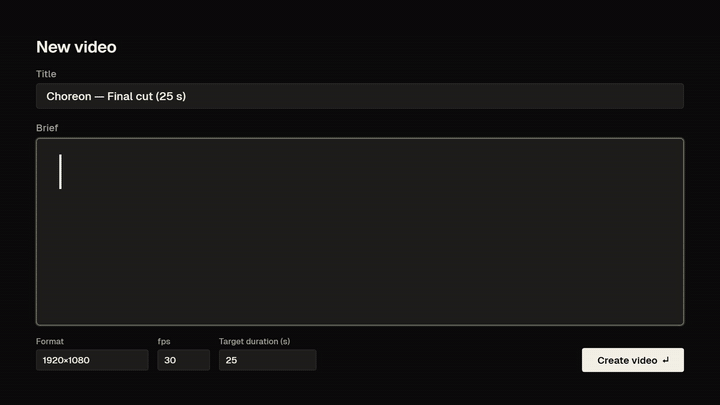
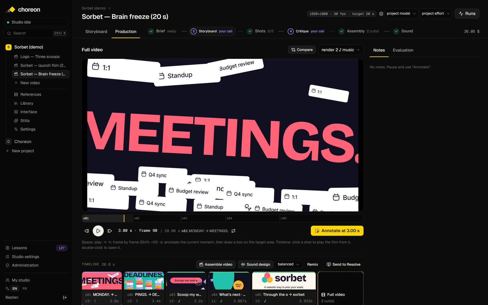
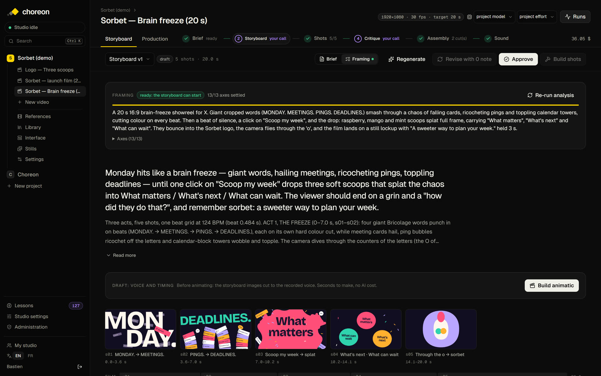
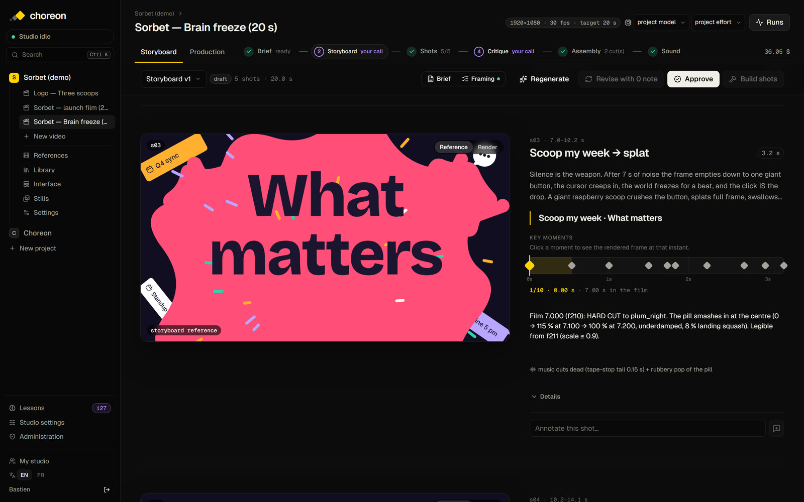
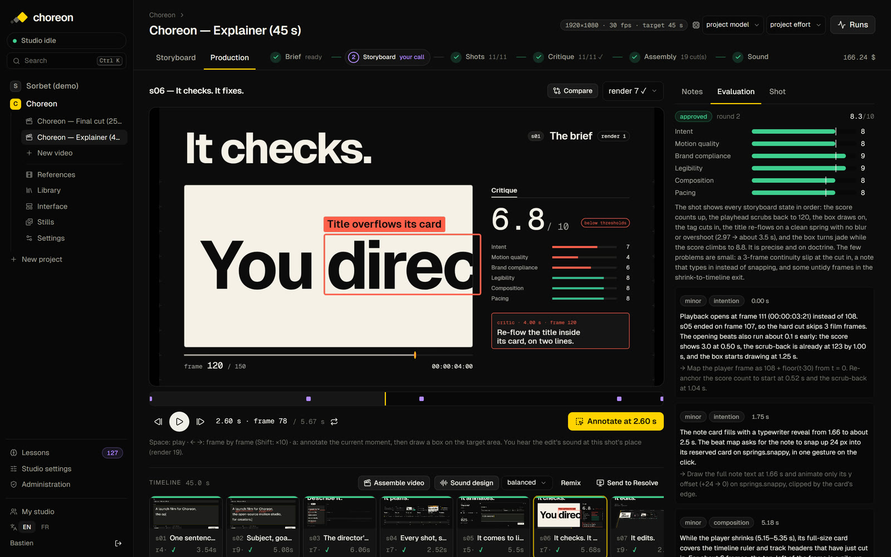
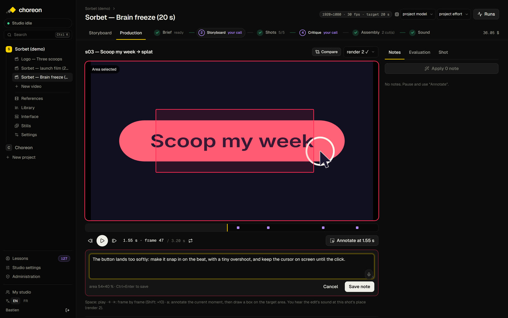

<p align="center"></p>

<h1 align="center">Choreon</h1>

<h3 align="center">An AI motion design studio. You direct, Choreon animates.</h3>

<p align="center">
Brief → storyboard → shots coded frame by frame → critique and auto-fix → edit → sound.<br>
Open source, local-first, runs on your Claude subscription or API key.
</p>

<p align="center"><a href="docs/media/choreon-explainer.mp4"></a><br>
<sub><b>Choreon, explained by Choreon.</b> 45 s with voice-over, made with Choreon: framing, storyboard, the voice recorded in one take and the shots cut to its words, 11 coded shots, critique and fixes, edit, music and sound. The few touch-ups done by hand along the way each became a fix in the studio. Click for the MP4 with sound.</sub></p>

<p align="center">More films made with Choreon: <a href="docs/media/choreon-final-cut.mp4">Choreon launch cut (25 s)</a> · <a href="docs/media/sorbet-brain-freeze.mp4">Sorbet "Brain freeze" (20 s)</a> · <a href="docs/media/sorbet-launch.mp4">Sorbet launch film (20 s)</a> · <a href="docs/media/sorbet-logo.mp4">Sorbet logo reveal (6 s)</a><br>
<sub>Sorbet is a fictional brand; its brief ships in <code>scripts/seed-demo.ts</code>.</sub></p>

## A look inside

<p align="center"><br>
<sub><b>The edit.</b> The film plays as one piece with its sound; click a shot to play from it, double-click to open it. Every render, note and score is one click away.</sub></p>

<table>
<tr>
<td width="50%"><br><sub><b>Framing, then storyboard.</b> The director settles 13 axes with you before drawing anything, then breaks the film into shots, each with a reference frame.</sub></td>
<td width="50%"><br><sub><b>Every shot, timed.</b> Intent, on-screen text and a beat map of key moments: the choreography the animator, the critic and the sound designer all follow.</sub></td>
</tr>
<tr>
<td width="50%"><br><sub><b>A critic that doesn't flatter.</b> Each render is scored on six axes against the brand's own doctrine; below the bar, the animator fixes it, round after round.</sub></td>
<td width="50%"><br><sub><b>Direct on the frame.</b> Pause, box the problem, say what you want. The note becomes the shot's new plan, and the critic holds the shot to it.</sub></td>
</tr>
</table>

---

Choreon is a production pipeline for **motion design videos** (product launches, logo reveals, UI walkthroughs, social cuts) run by a crew of Claude agents, with you as the director:

- **Framing interview** — before anything is drawn, the director agent challenges your brief on 13 axes (goal, audience, locked message, hook, arc, rhythm, product truth, sound, end frame, format…) and asks precise questions with options and a default. Nothing starts until each axis is decided or dismissed.
- **Storyboard** — shots with intent, visuals, on-screen text and a **timed list of states**, plus a reference frame for each. Annotate any shot, revise, compare versions.
- **Shots in code** — each shot is a `scene.html` animated with a small deterministic runtime (critical springs, tweens, tracks, layered logo, brand fonts), rendered frame by frame by headless Chromium and ffmpeg, with real motion blur.
- **Critique loop** — a critic agent scores every render against the project's grid (contact sheet, film strip, phone preview), and the animator fixes what falls below the bar, for a capped number of rounds. Then you decide.
- **Voice-over and animatic** — the script is recorded in one take (Gemini TTS), every word timed (Whisper), the shots cut to the words. An animatic (storyboard frames over the voice) validates story, voice and timing in seconds, before a single shot is animated.
- **Frame-accurate notes** — pause anywhere, draw a box, say what's wrong (dictation built in). Notes are routed automatically (shot fix, storyboard, global style) and applied surgically with the exact annotated frame. An applied note becomes the shot's new plan, so the critic judges against it instead of pulling the shot back.
- **Sound design** — real recordings, not synth bleeps: a "one sound per gesture" doctrine, three dosages (subtle, balanced, with music). The mix keeps a fixed order, voice > music > effects, with ducking under the voice.
- **UI kits from any website** — give it a URL (even behind a login), it rebuilds the interface elements (nav, inputs, buttons, cards…) as **layered SVG** in two variants, faithful and simplified, ready to animate.
- **A studio that learns** — recurring mistakes become short rules ("lessons"), validated by you, injected into every agent and checked by the critic.
- **Any style, brand-true by construction** — the studio rules are pure craft (timing, legibility, continuity, product truth) and say nothing about taste. Each project carries its identity and its taste: `DESIGN.md`, `motion.md` (the motion doctrine), colours, fonts, layered logo, and its own `brand/house-rules.md` (bans and permissions). A calm editorial brand and a loud playful one live side by side; the critic judges each against its own doctrine, and the studio's memory keeps style lessons per project.

Also: still ads from templates (batch rendering), reference analysis (cuts, rhythm, palette, frame-by-frame motion energy and easing), a shared studio for a trusted team (projects grouped by organization, see [Security model](#security-model)), bilingual UI (English / French), export to DaVinci Resolve.

## Quick start

Requirements: [Bun](https://bun.sh) ≥ 1.3, Node ≥ 22, and either [Claude Code](https://claude.com/claude-code) signed in to your subscription (`claude`) or an Anthropic API key. Optional: the OpenAI [`codex`](https://github.com/openai/codex) CLI, signed in, for image generation.

```bash
git clone https://github.com/vialcollet/choreon && cd choreon
bun install
npx playwright install chromium
bun scripts/seed-demo.ts        # demo project "Sorbet" (a fictional brand)
bun run dev                     # http://localhost:5610
```

Open the app, create the first account (it becomes the studio admin), then open **Sorbet (demo) ▸ Logo — Three scoops** and start the framing interview.

On a bare Linux machine (no browser libraries installed), use `npx playwright install --with-deps chromium` instead.

`bun run build && bun run start` runs the production build, which listens on 127.0.0.1 unless `HOST` is set (port `PORT`, 3000 by default). Behind a reverse proxy, set `ORIGIN` to the studio's public URL.

### API keys

Everything except the voice-over (Gemini and Groq keys) works with zero keys if Claude Code is signed in. Image generation (**Generate an image (Codex)** in the library, and storyboard frames with `refMethod: "codex"`) needs the optional OpenAI `codex` CLI, signed in. Otherwise, enter keys either in **Studio settings ▸ API keys** (stored in the local database) or in `.env` (see [`.env.example`](.env.example); `.env` always wins):

| Key | Used for | Without it |
|---|---|---|
| `ANTHROPIC_API_KEY` | All agents | Your Claude subscription via Claude Code |
| `GROQ_API_KEY` or `OPENAI_API_KEY` | Dictation (Whisper) in every text field | No dictation |
| `TYPESAFE_API_KEY` | Note routing by [Jev](https://typesafe.ai) | Routed by Claude Haiku, then by a heuristic |
| `GEMINI_API_KEY` (+ `GROQ_API_KEY`) | Voice-over: Gemini reads the script, Groq Whisper times every word | No voice-over (the animatic stays silent) |

**Claude authentication** (Studio settings ▸ Claude): *auto* uses the API key when there is one and the subscription otherwise; you can force either.

**Cost.** Agents are billed per use (API) or count against your Claude plan. For scale, the 20 s Sorbet film shown in [`docs/media/screens/edit.jpg`](docs/media/screens/edit.jpg) cost about $36 in API usage with Opus at high effort. Model and effort are set per role in Studio settings and per project.

### Sounds (optional)

The repo ships CC0 interface sounds from [Kenney](https://kenney.nl). For the full bank (whooshes, impacts, ambiences, music), download the free [Mixkit](https://mixkit.co) selection into `data/`. Mixkit files may not be redistributed, so they aren't in the repo:

```bash
node engine/sfx-bank/fetch-mixkit.mjs
node engine/sfx-bank/build-index.mjs
```

## Security model

Choreon is a local studio, not a hosted service. Read [SECURITY.md](SECURITY.md) before sharing it:

- It is a **local, single-operator tool**: one studio on one machine.
- Its **agents run arbitrary code with full tools** (shell, file system) as the server's OS user, and read imported content (briefs, references, harvested pages), so a prompt injection can run commands.
- **Every account must be trusted.** Anyone who can sign in can, through an agent, act as the server's user.
- **Never expose the studio to the internet.** To reach it remotely, use a VPN or an authenticated reverse proxy. `bun run start` listens on 127.0.0.1; set `HOST=0.0.0.0` to expose it on your network, and create the first account (the admin) locally first.
- **Organizations organize projects; they do not isolate untrusted users.**

## How a video is made

1. **Project** — a brand (`brand/`: `motion.md`, `DESIGN.md`, `brand.json`, layered SVG logo, fonts), a library, UI kits, videos.
2. **Framing** — the director turns the brief into decisions; you answer, pick an option or let it decide.
3. **Storyboard** — generated from the brief and decisions; annotate, revise, approve.
4. **Voice and animatic** — record the voice-over in one take; the shots are cut to its words; watch the animatic (frames over the voice) and fix story or timing while it costs nothing.
5. **Build** — the animator writes each shot and checks its own stills; the studio renders the MP4. Shots are built in parallel (4 by default).
6. **Critique** — scores per axis with thresholds; auto-fix below the bar, capped rounds.
7. **Production** — the edit plays as one film (click a shot to play from it, double-click to open it, heard with the edit's sound), frame-by-frame player, notes on the exact frame and region, surgical fixes.
8. **Assembly and sound** — best render of each shot, then sound design in the chosen dosage, mixed under the voice.

The content language (storyboards, critiques, on-screen text) is a project setting, independent of the UI language.

## Architecture

| Layer | Files | Role |
|---|---|---|
| Engine | `engine/runtime/motion.js` | Scene runtime: `scene()`, tweens, critical springs, `track`, layered logo, text, project fonts, `loadUiKit()` |
| | `engine/render.mjs` | Deterministic `seek(t)` rendering: headless Chromium (Playwright) → ffmpeg, motion blur by sub-frames |
| | `engine/qa.mjs` | Contact sheet, film strip, phone preview, exact frame with highlighted region |
| | `engine/sfx.mjs` | Sound design: cue sheet → effects stem; final mix voice > music > effects (ducking, -14 LUFS) |
| | `engine/voice.mjs` | Voice-over: one-take TTS, Whisper check and word timings, alignment to the storyboard lines |
| | `engine/animatic.mjs` | Animatic: storyboard frames held for each shot's length, over the voice |
| | `engine/ui-harvest.mjs` | Website → UI elements → layered SVG kit |
| | `engine/analyze.mjs` | Reference analysis: cuts, palette, motion energy, easing |
| Server | `src/lib/server/jobs.ts` | Jobs and chains (build → render → eval → auto-fix), queues, parallelism |
| | `src/lib/server/agent.ts` | Claude agents (Agent SDK); every message becomes a run event |
| | `src/lib/server/store.ts`, `db.ts` | SQLite (bun:sqlite): projects, videos, storyboards, shots, notes, renders, evals, runs |
| UI | `src/routes/…` | SvelteKit 2 + Svelte 5 |

Data lives in `data/` (git-ignored): `studio.db` and `projects/<project>/`, the agents' workspace. Stack: SvelteKit, Svelte 5, Bun, SQLite, [better-auth](https://better-auth.com), Claude Agent SDK, Playwright, ffmpeg.

### DaVinci Resolve (optional)

The free version of Resolve has no external scripting API, so Choreon talks to it through a small Lua bridge run inside Resolve. It imports the latest shot renders and builds a timeline, for when a motion piece has to be cut with filmed footage.

Copy [`engine/resolve/choreon_bridge.lua`](engine/resolve/choreon_bridge.lua) to Resolve's `Fusion/Scripts/Utility` folder (Windows: `%APPDATA%\Blackmagic Design\DaVinci Resolve\Support\Fusion\Scripts\Utility`; macOS: `~/Library/Application Support/Blackmagic Design/DaVinci Resolve/Fusion/Scripts/Utility`), then run **Workspace ▸ Scripts ▸ choreon_bridge** and press **Export to Resolve** in a video's Production tab.

## License

[MIT](LICENSE). Third-party components are listed in [THIRD_PARTY.md](THIRD_PARTY.md): FFmpeg (via `ffmpeg-static`) is GPL, the fonts are OFL, the Kenney sounds are CC0 and Mixkit has its own license. "Sorbet" is a fictional brand made for the demo.

---

<p align="center">Made by the team behind <a href="https://omeon.ai"><b>Omeon</b></a>.</p>
